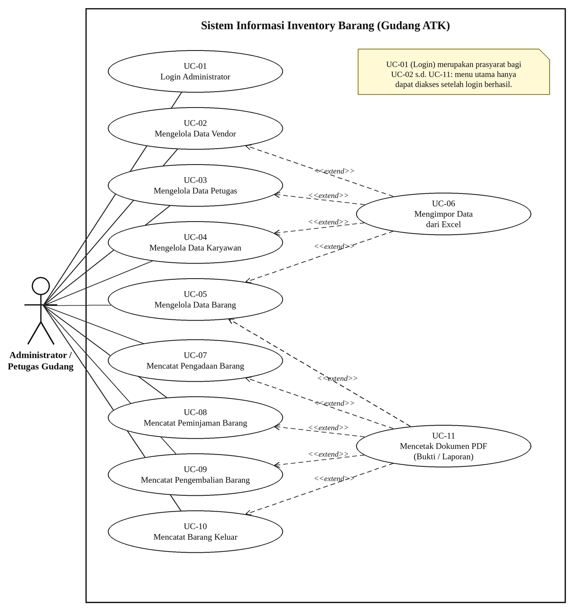
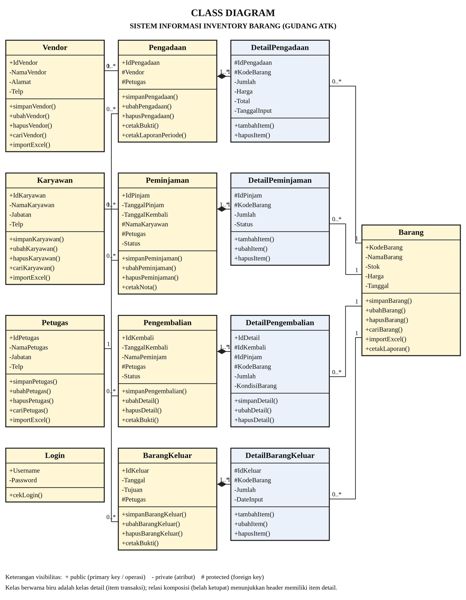

# Sistem Informasi Inventory Barang — Gudang ATK

> Dokumen **Software Requirements Specification (SRS)** untuk *Project Aplikasi Barang*, aplikasi desktop pencatatan persediaan Alat Tulis Kantor (ATK).

| | |
|---|---|
| **Kelompok** | Kelompok 3 |
| **Disusun oleh** | Saripkudin<br>Ratno<br>Muhammad Dhaffa Adhi Ramadhan |
| **Institusi** | Universitas Indraprasta PGRI (UNINDRA) |
| **Mata Kuliah** | Rekayasa Perangkat Lunak |
| **Versi** | 1.0 — November 2026 |

---

## 📄 Dokumen

| Dokumen | Keterangan |
|---|---|
| [SRS (Markdown)](docs/SRS.md) | Versi baca langsung di GitHub, lengkap dengan diagram |
| [SRS (Word .docx)](docs/SRS_Sistem_Informasi_Inventory_Barang.docx) | Dokumen asli laporan |
| [Diagram](docs/diagrams/) | Seluruh diagram UML dalam format PNG |

Template SRS mengacu pada Karl E. Wiegers dan IEEE Std 29148-2018.

## 🧭 Gambaran Sistem

Aplikasi desktop **Java Swing** yang terhubung langsung ke basis data **MySQL** (`project_barang`) melalui JDBC. Satu-satunya pengguna adalah **Administrator / Petugas Gudang**.

**Fitur utama:**

- 🔐 Login administrator
- 📦 Data master: Barang, Vendor, Petugas, Karyawan (CRUD, pencarian, impor Excel)
- 🛒 Transaksi **Pengadaan** (`PGD###`) — stok bertambah
- 🤝 Transaksi **Peminjaman** (`PJM###`) — stok berkurang, status *Dipinjam* / *Diberikan*
- ↩️ Transaksi **Pengembalian** (`KMB###`) — kondisi *Good* menambah stok, *Broken* tidak
- 📤 Transaksi **Barang Keluar** (`KLR###`)
- 🖨️ Cetak bukti transaksi dan laporan ke **PDF**

## 🛠️ Teknologi

| Komponen | Teknologi |
|---|---|
| Bahasa & UI | Java, Swing (Nimbus look and feel), NetBeans (Ant) |
| Basis data | MySQL (`localhost:3306/project_barang`), MySQL Connector/J 5.1.23 |
| PDF | iText 5.5.13.3 |
| Impor Excel | Apache POI 5.2.3 (.xlsx) |
| Pemilih tanggal | JCalendar 1.4 |

## 📋 Ringkasan Kebutuhan

| Modul | Kode Requirement |
|---|---|
| Autentikasi Administrator | FR-01 – FR-03 |
| Data Master Barang | FR-04 – FR-08 |
| Data Master Vendor, Petugas, Karyawan | FR-09 – FR-13 |
| Impor Data dari Excel | FR-14 – FR-15 |
| Transaksi Pengadaan | FR-16 – FR-22 |
| Transaksi Peminjaman | FR-23 – FR-28 |
| Transaksi Pengembalian | FR-29 – FR-34 |
| Transaksi Barang Keluar | FR-35 – FR-38 |
| Menu Utama & Navigasi | FR-39 – FR-40 |
| Non-fungsional (performa, keamanan, kualitas, aturan bisnis) | NFR-01 – NFR-15 |

## 📐 Model Analisis (UML)

| Diagram | Jumlah | File |
|---|---|---|
| Use Case Diagram | 1 | [usecase.png](docs/diagrams/usecase.png) |
| Activity Diagram | 11 (AD-01 – AD-11) | `docs/diagrams/ad01.png` … `ad11.png` |
| Sequence Diagram | 11 (SD-01 – SD-11) | `docs/diagrams/sd01.png` … `sd11.png` |
| State Machine Diagram | 1 | [state.png](docs/diagrams/state.png) |
| Class Diagram | 1 | [class.png](docs/diagrams/class.png) |
| Deployment Diagram | 1 | [deployment.png](docs/diagrams/deployment.png) |

### Use Case Diagram



### Class Diagram



## 📁 Struktur Repository

```
.
├── README.md
└── docs/
    ├── SRS.md                                   # SRS versi Markdown
    ├── SRS_Sistem_Informasi_Inventory_Barang.docx
    └── diagrams/                                # Diagram UML (PNG)
```

## ▶️ Menjalankan Aplikasi

1. Pastikan MySQL Server aktif dan basis data `project_barang` beserta tabelnya sudah tersedia.
2. Jalankan dari folder `dist`:
   ```bash
   java -jar Project_Aplikasi_Barang.jar
   ```

---

© 2026 Saripkudin, Ratno, Muhammad Dhaffa Adhi Ramadhan — Universitas Indraprasta PGRI
