**Software Requirements**

**Specification**

**for**

**SISTEM INFORMASI INVENTORY BARANG**

**GUDANG ATK**

**(PROJECT APLIKASI BARANG)**

**Prepared by**

Saripkudin  
Ratno  
Muhammad Dhaffa Adhi Ramadhan

**Universitas Indraprasta PGRI (UNINDRA)**

**November 2026**

**Table of Contents**

**1. Introduction 3**

> 1.1 Purpose 3
>
> 1.2 Document Conventions 3
>
> 1.3 Intended Audience and Reading Suggestions 3
>
> 1.4 Product Scope 3
>
> 1.5 References 3

**2. Overall Description 4**

> 2.1 Product Perspective 4
>
> 2.2 Product Functions 4
>
> 2.3 User Classes and Characteristics 4
>
> 2.4 Operating Environment 4
>
> 2.5 Design and Implementation Constraints 4
>
> 2.6 User Documentation 5
>
> 2.7 Assumptions and Dependencies 5

**3. External Interface Requirements 6**

> 3.1 User Interfaces 6
>
> 3.2 Hardware Interfaces 6
>
> 3.3 Software Interfaces 6
>
> 3.4 Communications Interfaces 6

**4. System Features 7**

> 4.1 Sistem Autentikasi Administrator 7
>
> 4.2 Modul Data Master Barang 7
>
> 4.3 Modul Data Master Vendor, Petugas, dan Karyawan 7
>
> 4.4 Modul Impor Data dari Excel 7
>
> 4.5 Modul Transaksi Pengadaan Barang 8
>
> 4.6 Modul Transaksi Peminjaman Barang 8
>
> 4.7 Modul Transaksi Pengembalian Barang 8
>
> 4.8 Modul Transaksi Barang Keluar 9
>
> 4.9 Modul Menu Utama dan Navigasi 9

**5. Other Non-Functional Requirements 10**

> 5.1 Performance Requirements 10
>
> 5.2 Safety Requirements 10
>
> 5.3 Security Requirements 10
>
> 5.4 Software Quality Attributes 10
>
> 5.5 Business Rules 10

**6. Other Requirements 11**

**Appendix A: Glossary 12**

**Appendix B: Analysis Models 13**

> B.1 Identifikasi Aktor Sistem 13
>
> B.2 Daftar Use Case dan Relasinya 13
>
> B.3 Use Case Diagram 14
>
> B.4 Use Case Scenario 15
>
> B.5 Activity Diagram 16
>
> B.6 Sequence Diagram 27
>
> B.7 State Machine Diagram 38
>
> B.8 Class Diagram 40
>
> B.9 Deployment Diagram 44
>
> B.10 Model Analisis Lain (Direncanakan) 45

**Appendix C: To Be Determined List 46**

# 1. Introduction

## 1.1 Purpose

Dokumen ini mendeskripsikan spesifikasi kebutuhan perangkat lunak untuk
**Sistem Informasi Inventory Barang Gudang ATK (Project Aplikasi
Barang)**. Dokumen ini ditujukan bagi pengembang, penguji, dan
*stakeholder* akademik sebagai acuan utama dalam perancangan,
pengembangan, pengujian, serta pemeliharaan sistem.

## 1.2 Document Conventions

Penulisan dokumen ini menggunakan konvensi kode **FR (Functional
Requirement)** untuk kebutuhan fungsional dan **NFR (Non-Functional
Requirement)** untuk kebutuhan non-fungsional. Pada Appendix B digunakan
kode **UC** untuk *use case*, **AD** untuk *activity diagram*, dan
**SD** untuk *sequence diagram*. Setiap requirement bersifat unik,
terukur, dan dapat diuji.

## 1.3 Intended Audience and Reading Suggestions

Dokumen ini ditujukan untuk:

- **Developer/Mahasiswa Pengembang:** sebagai acuan implementasi dan
  pemeliharaan kode (Java Swing, JDBC MySQL, iText, Apache POI).

- **Dosen Pengampu Mata Kuliah Rekayasa Perangkat Lunak:** sebagai bahan
  evaluasi kesesuaian standar tugas.

- **Administrator / Petugas Gudang:** sebagai pengguna operasional
  aplikasi untuk mengelola data master dan transaksi barang.

- **Pengelola Gudang / Atasan:** sebagai pihak yang memahami alur
  pencatatan dan dokumen bukti transaksi yang dihasilkan sistem.

## 1.4 Product Scope

Sistem ini merupakan aplikasi desktop (*desktop application*) berbasis
Java Swing yang terhubung langsung ke basis data MySQL, dan mencakup:

- Autentikasi administrator melalui halaman *login* sebelum menu utama
  dapat diakses.

- Pengelolaan data master: barang, vendor, petugas, dan karyawan,
  termasuk pencarian dan impor data dari berkas Excel.

- Pencatatan transaksi **pengadaan** barang dari vendor, **peminjaman**
  barang oleh karyawan, **pengembalian** barang pinjaman, dan **barang
  keluar**.

- Pembaruan stok barang secara otomatis sesuai jenis transaksi.

- Pembuatan dokumen PDF: bukti pengadaan, nota peminjaman, bukti
  pengembalian, bukti barang keluar, laporan data barang, dan laporan
  pengadaan per periode.

Sistem bertujuan membuat pencatatan persediaan alat tulis kantor (ATK)
lebih tertib, akurat, dan terdokumentasi dibandingkan pencatatan manual.

## 1.5 References

- IEEE Std 29148-2018 Requirements Engineering; Template SRS Karl E.
  Wiegers.

- Kode sumber dan konfigurasi proyek NetBeans *Project_Aplikasi_Barang*
  (paket project_barang).

- Dokumentasi iText 5.5.13.3, Apache POI 5.2.3, JCalendar 1.4, dan MySQL
  Connector/J 5.1.23.

# 2. Overall Description

## 2.1 Product Perspective

Sistem dirancang sebagai aplikasi mandiri (*standalone system*) dua
lapis: antarmuka dan logika aplikasi berjalan dalam satu program Java
Swing, sedangkan data disimpan pada basis data MySQL *project_barang*
yang diakses melalui JDBC (kelas *Koneksi*, alamat *localhost:3306*).
Tidak terdapat server aplikasi terpisah. Dokumen PDF yang dihasilkan
disimpan pada sistem berkas komputer pengguna.

## 2.2 Product Functions

- Autentikasi administrator dengan *username* dan *password*.

- Pengelolaan data master barang (kode, nama, stok, harga, tanggal),
  vendor, petugas, dan karyawan.

- Pembangkitan ID otomatis berprefiks untuk vendor (VND), petugas (PTG),
  karyawan (KRY), dan transaksi: pengadaan (PGD), peminjaman (PJM),
  pengembalian (KMB), barang keluar (KLR).

- Pencatatan transaksi pengadaan, peminjaman, pengembalian, dan barang
  keluar berikut item detailnya.

- Pembaruan stok otomatis: bertambah pada pengadaan dan pengembalian
  barang berkondisi *Good*, berkurang pada peminjaman.

- Impor data master dari berkas Excel (.xlsx) dan pencarian data
  berdasarkan nama.

- Pencetakan bukti transaksi dan laporan dalam format PDF.

## 2.3 User Classes and Characteristics

- **Administrator / Petugas Gudang:** satu-satunya kelas pengguna yang
  melakukan *login* dan mengoperasikan seluruh fitur. Diasumsikan
  memahami pengoperasian komputer dasar dan istilah persediaan barang.

- **Pihak non-pengguna:** *karyawan* (peminjam barang) dan *vendor*
  (pemasok) hanya tercatat sebagai data dan tidak berinteraksi langsung
  dengan aplikasi.

## 2.4 Operating Environment

- **Sisi Aplikasi:** Java Runtime/JDK dengan pustaka Swing (*look and
  feel* Nimbus), dijalankan dari berkas *Project_Aplikasi_Barang.jar*
  pada sistem operasi desktop (dikembangkan pada Windows).

- **Sisi Basis Data:** MySQL Server pada *localhost* port 3306 dengan
  basis data *project_barang*, diakses menggunakan MySQL Connector/J
  5.1.23.

## 2.5 Design and Implementation Constraints

- Antarmuka dibangun dengan komponen Java Swing (JFrame, JTable,
  JComboBox, JDateChooser) pada proyek NetBeans berbasis Ant.

- Koneksi basis data ditetapkan pada kelas *Koneksi*
  (*jdbc:mysql://localhost:3306/project_barang*, pengguna *root*).

- Pembuatan PDF menggunakan iText; impor Excel menggunakan Apache POI
  (format .xlsx).

- Dokumen PDF disimpan pada folder per kategori dan per tanggal di bawah
  direktori *Documents/NetBeansProjects/Project_Aplikasi_Barang* milik
  pengguna.

## 2.6 User Documentation

- Panduan menjalankan aplikasi (*java -jar Project_Aplikasi_Barang.jar*
  dari folder *dist*).

- Panduan penggunaan menu Master dan Transaksi bagi administrator.

## 2.7 Assumptions and Dependencies

- MySQL Server aktif dan basis data *project_barang* beserta seluruh
  tabelnya sudah tersedia sebelum aplikasi dijalankan.

- Komputer memiliki Java yang kompatibel dan folder dokumen pengguna
  dapat ditulis.

- Tanggal dan waktu transaksi mengikuti pengaturan jam komputer; zona
  waktu yang digunakan adalah WIB (GMT+7).

- Aplikasi pembaca PDF terpasang pada komputer untuk membuka dokumen
  yang dihasilkan.

# 3. External Interface Requirements

## 3.1 User Interfaces

- Halaman *Login Administrator*: isian *username*, *password*, dan
  tombol Login.

- Halaman *Menu Utama* berjudul “SISTEM INFORMASI INVENTORY BARANG”
  dengan menu **Master** (Barang, Vendor, Petugas, Karyawan) dan
  **Transaksi** (Pengadaan, Barang Keluar, Peminjaman, Pengembalian).

- Form data master (Barang, Vendor, Petugas, Karyawan): isian data,
  tabel data, kolom cari, serta tombol Simpan, Edit, Hapus, Clear,
  Import, dan Back (Barang juga memiliki tombol Cetak).

- Form transaksi (Pengadaan, Peminjaman, Pengembalian, Barang Keluar):
  isian header, tabel item, tombol Tambah, Simpan, Edit, Hapus, Reset,
  Cetak, dan Back.

## 3.2 Hardware Interfaces

- Komputer/laptop dengan monitor, *keyboard*, dan *mouse* sebagai
  perangkat operasional administrator.

- Printer (opsional) untuk mencetak berkas PDF melalui aplikasi pembaca
  PDF.

## 3.3 Software Interfaces

- Java Runtime Environment dan pustaka Swing/AWT.

- MySQL Server dan MySQL Connector/J (JDBC).

- iText (pembuatan PDF), Apache POI (baca Excel), dan JCalendar (pemilih
  tanggal).

- JasperReports 6.21.0 tersedia pada *classpath* beserta berkas desain
  laporan (*laporan_barang.jrxml*); pada versi ini pembuatan PDF
  dilakukan menggunakan iText.

## 3.4 Communications Interfaces

- JDBC melalui TCP port 3306 ke MySQL pada *localhost* untuk seluruh
  operasi data.

- Operasi berkas lokal (*file I/O*) untuk membaca berkas Excel dan
  menulis berkas PDF.

# 4. System Features

## 4.1 Sistem Autentikasi Administrator

Administrator melakukan *login* menggunakan *username* dan *password*
untuk membuka Menu Utama.

**Functional Requirements:**

- **FR-01:** Sistem harus memverifikasi *username* dan *password*
  terhadap tabel *login* sebelum menampilkan Menu Utama.

- **FR-02:** Sistem menolak *login* dan menampilkan pesan “Login Gagal!”
  jika data yang dimasukkan tidak sesuai.

- **FR-03:** Jika *login* berhasil, sistem menampilkan Menu Utama dan
  menutup halaman *login*.

## 4.2 Modul Data Master Barang

Administrator mengelola daftar barang ATK beserta stok dan harganya.

**Functional Requirements:**

- **FR-04:** Sistem dapat menyimpan data barang baru (kode barang, nama
  barang, stok, harga, tanggal).

- **FR-05:** Sistem dapat mengubah data barang berdasarkan kode barang
  yang dipilih dari tabel.

- **FR-06:** Sistem dapat menghapus data barang berdasarkan kode barang.

- **FR-07:** Sistem menampilkan seluruh data barang pada tabel dan
  menyediakan pencarian berdasarkan nama barang.

- **FR-08:** Sistem dapat mencetak laporan data barang ke PDF berjudul
  “LAPORAN DATA BARANG” yang diurutkan berdasarkan kode barang.

## 4.3 Modul Data Master Vendor, Petugas, dan Karyawan

Administrator mengelola data pemasok (vendor), petugas pencatat
transaksi, dan karyawan peminjam.

**Functional Requirements:**

- **FR-09:** Sistem menampilkan ID otomatis berprefiks (VND untuk
  vendor, PTG untuk petugas, KRY untuk karyawan) berdasarkan ID
  terakhir.

- **FR-10:** Sistem dapat menyimpan, mengubah, dan menghapus data vendor
  (nama, alamat, telp), petugas (nama, jabatan, telp), dan karyawan
  (nama, jabatan, telp).

- **FR-11:** Sistem menampilkan pesan peringatan apabila tombol Edit
  atau Hapus ditekan tanpa memilih baris data (petugas dan karyawan),
  dan apabila data karyawan belum lengkap saat disimpan.

- **FR-12:** Sistem meminta konfirmasi sebelum menghapus data karyawan.

- **FR-13:** Sistem menyediakan pencarian data berdasarkan nama pada
  masing-masing form master.

## 4.4 Modul Impor Data dari Excel

Administrator dapat memasukkan banyak data master sekaligus dari berkas
Excel.

**Functional Requirements:**

- **FR-14:** Sistem menyediakan tombol Import yang membuka dialog
  pemilih berkas untuk memilih berkas Excel (.xlsx) pada form Barang,
  Vendor, Petugas, dan Karyawan.

- **FR-15:** Sistem membaca setiap baris Excel, melewati baris yang
  tidak valid (pada data barang: kode atau nama kosong), menyimpan baris
  valid ke tabel, lalu menampilkan pesan hasil impor.

## 4.5 Modul Transaksi Pengadaan Barang

Administrator mencatat barang yang dibeli dari vendor; stok barang
bertambah secara otomatis.

**Functional Requirements:**

- **FR-16:** Sistem menampilkan ID pengadaan otomatis berformat PGD###
  serta pilihan barang, vendor, dan petugas dari data master.

- **FR-17:** Sistem menghitung total item secara otomatis (jumlah ×
  harga) dan menampilkan pesan “Lengkapi data barang dulu!” jika data
  item belum lengkap saat tombol Tambah ditekan.

- **FR-18:** Saat Simpan, sistem memvalidasi bahwa item, vendor, dan
  petugas telah terisi serta ID pengadaan belum pernah tersimpan.

- **FR-19:** Sistem menyimpan header pengadaan, detail item, dan
  menambah stok barang sebesar jumlah item dalam satu transaksi basis
  data (*commit*); jika terjadi kegagalan, seluruh perubahan dibatalkan
  (*rollback*).

- **FR-20:** Sistem dapat mengubah vendor dan petugas pada transaksi,
  serta menghapus item dan menghapus transaksi setelah konfirmasi
  pengguna.

- **FR-21:** Sistem dapat mencetak bukti pengadaan per ID (“BUKTI
  PENGADAAN BARANG”) berisi daftar item, sub total, dan *grand total*.

- **FR-22:** Sistem dapat mencetak laporan pengadaan per periode
  (“LAPORAN PENGADAAN BARANG”) berdasarkan rentang tanggal, memuat total
  data dan *grand total*.

## 4.6 Modul Transaksi Peminjaman Barang

Administrator mencatat barang yang dipinjam atau diberikan kepada
karyawan; stok berkurang secara otomatis.

**Functional Requirements:**

- **FR-23:** Sistem menampilkan ID peminjaman otomatis berformat PJM###
  serta pilihan karyawan, petugas, dan hanya barang yang stoknya lebih
  dari nol.

- **FR-24:** Setiap item memiliki status **Dipinjam** (wajib mengisi
  tanggal kembali) atau **Diberikan** (tidak dikembalikan); sistem
  mewajibkan tanggal pinjam dan jumlah terisi.

- **FR-25:** Saat Simpan, sistem menyimpan header dan detail peminjaman
  serta mengurangi stok barang sebesar jumlah item.

- **FR-26:** Sistem dapat mengubah header dan item peminjaman.

- **FR-27:** Saat item atau transaksi dihapus setelah konfirmasi, sistem
  mengembalikan stok barang sesuai jumlah yang dihapus.

- **FR-28:** Sistem dapat mencetak nota peminjaman ke PDF.

## 4.7 Modul Transaksi Pengembalian Barang

Administrator mencatat pengembalian barang pinjaman beserta kondisinya.

**Functional Requirements:**

- **FR-29:** Sistem menampilkan ID pengembalian otomatis berformat
  KMB### dan hanya menampilkan ID pinjam yang masih memiliki barang
  berstatus Dipinjam; data peminjam dan barang terisi otomatis setelah
  ID pinjam dipilih.

- **FR-30:** Saat Simpan, sistem memvalidasi ID pinjam, tanggal kembali,
  dan kelengkapan data barang, serta menolak barang yang sudah tidak
  berstatus Dipinjam.

- **FR-31:** Sistem mencatat kondisi barang (**Good** atau **Broken**),
  mengubah status item peminjaman menjadi Dikembalikan, dan mengubah
  status peminjaman menjadi Dikembalikan bila tidak ada lagi item
  berstatus Dipinjam.

- **FR-32:** Sistem menambah stok barang hanya apabila kondisi barang
  *Good*.

- **FR-33:** Sistem dapat mengubah dan menghapus detail pengembalian
  dengan menyesuaikan stok sesuai kondisi barang.

- **FR-34:** Sistem dapat mencetak bukti pengembalian ke PDF.

## 4.8 Modul Transaksi Barang Keluar

Administrator mencatat barang yang dikeluarkan dari gudang untuk
keperluan tertentu.

**Functional Requirements:**

- **FR-35:** Sistem menampilkan ID barang keluar otomatis berformat
  KLR### serta pilihan tujuan (Operasional, Maintenance, Project,
  Teknisi Lapangan, Gudang, Divisi IT, Lainnya), petugas, dan barang
  berstok lebih dari nol.

- **FR-36:** Saat Simpan, sistem memvalidasi tujuan, petugas, dan item,
  lalu menyimpan header dan detail dalam satu transaksi basis data
  (*commit*/*rollback*).

- **FR-37:** Sistem dapat mengubah header dan item, menghapus item,
  serta menghapus transaksi setelah konfirmasi.

- **FR-38:** Sistem dapat mencetak bukti barang keluar ke PDF beserta
  kolom tanda tangan.

## 4.9 Modul Menu Utama dan Navigasi

Menu Utama menjadi pusat akses seluruh fitur setelah *login*.

**Functional Requirements:**

- **FR-39:** Sistem menampilkan menu Master dan Transaksi yang
  masing-masing membuka form yang bersesuaian.

- **FR-40:** Setiap form menyediakan tombol Back untuk kembali ke Menu
  Utama.

# 5. Other Non-Functional Requirements

## 5.1 Performance Requirements

- **NFR-01:** Operasi simpan, ubah, hapus, dan penampilan tabel pada
  basis data lokal selesai dalam ≤ 3 detik untuk data hingga 1.000
  baris.

- **NFR-02:** Pembuatan satu dokumen PDF selesai dalam ≤ 5 detik.

## 5.2 Safety Requirements

- **NFR-03:** Penyimpanan transaksi pengadaan dan barang keluar bersifat
  atomik (*commit*/*rollback*) agar header, detail, dan stok tidak
  berada dalam kondisi sebagian tersimpan.

- **NFR-04:** Penghapusan transaksi (pengadaan, peminjaman, barang
  keluar) dan data karyawan wajib didahului dialog konfirmasi Ya/Tidak.

## 5.3 Security Requirements

- **NFR-05:** Menu Utama hanya dapat dibuka setelah verifikasi *login*
  berhasil.

- **NFR-06:** Kueri verifikasi *login* menggunakan *PreparedStatement*
  berparameter.

- **NFR-07:** Kredensial basis data dikonfigurasi pada kelas *Koneksi*
  dan wajib diubah (kata sandi diisi) pada lingkungan operasional.

## 5.4 Software Quality Attributes

- **NFR-08 (Usability):** Antarmuka menggunakan menu, *combo box*, dan
  pemilih tanggal agar pengisian data minim kesalahan; pesan kesalahan
  dan konfirmasi ditampilkan dalam Bahasa Indonesia.

- **NFR-09 (Maintainability):** Setiap form diimplementasikan pada kelas
  tersendiri dan akses basis data dipusatkan pada kelas *Koneksi*.

- **NFR-10 (Reliability):** Kesalahan basis data atau berkas ditangani
  dengan *try-catch* dan ditampilkan melalui kotak dialog tanpa
  menghentikan aplikasi.

## 5.5 Business Rules

- **NFR-11:** Stok barang bertambah pada pengadaan, berkurang pada
  peminjaman, bertambah kembali pada pengembalian berkondisi *Good*, dan
  dikembalikan saat peminjaman dihapus.

- **NFR-12:** Barang dengan status **Diberikan** tidak perlu
  dikembalikan; barang berkondisi **Broken** tidak menambah stok.

- **NFR-13:** Barang berstatus **Dipinjam** wajib memiliki tanggal
  kembali.

- **NFR-14:** ID transaksi dibangkitkan berurutan dengan prefiks PGD,
  PJM, KMB, dan KLR.

- **NFR-15:** Peminjaman dianggap selesai (status Dikembalikan) hanya
  jika seluruh item berstatus Dipinjam telah dikembalikan.

# 6. Other Requirements

- Berkas PDF dinamai *ID_yyyyMMdd.pdf* dan disimpan pada folder
  *Pengadaan*, *Peminjaman*, *Pengembalian*, atau *Barang_Keluar* sesuai
  tanggal cetak; laporan periode disimpan pada
  *Pengadaan/Laporan_Periode*.

- Dokumen PDF memuat kop “GUDANG ATK” dan nilai uang ditampilkan dalam
  format Rupiah.

- Tanggal disimpan ke basis data dengan format *yyyy-MM-dd* dan
  mengikuti zona waktu WIB (GMT+7).

# Appendix A: Glossary

- **FR:** Functional Requirement (kebutuhan fungsional).

- **NFR:** Non-Functional Requirement (kebutuhan non-fungsional).

- **ATK:** Alat Tulis Kantor.

- **Inventory:** Persediaan barang yang dikelola gudang.

- **Pengadaan:** Proses pembelian/penerimaan barang dari vendor yang
  menambah stok.

- **Peminjaman:** Pengeluaran barang kepada karyawan, baik dipinjam
  (wajib kembali) maupun diberikan.

- **Pengembalian:** Pencatatan barang pinjaman yang dikembalikan beserta
  kondisinya.

- **Barang Keluar:** Pengeluaran barang dari gudang untuk tujuan
  operasional tertentu.

- **Vendor:** Pemasok yang menyediakan barang pada transaksi pengadaan.

- **Petugas:** Staf gudang yang tercatat sebagai pencatat transaksi.

- **Good / Broken:** Kondisi barang saat dikembalikan: baik / rusak.

- **JDBC:** Java Database Connectivity, antarmuka Java untuk mengakses
  basis data.

- **Swing:** Pustaka antarmuka grafis Java untuk aplikasi desktop.

- **iText / Apache POI:** Pustaka pembuat PDF / pembaca berkas Excel.

- **Aktor:** Pihak yang berinteraksi langsung dengan sistem dalam Use
  Case Diagram.

- **Use Case:** Gambaran fungsi sistem yang dilihat dari sisi aktor.

# Appendix B: Analysis Models

Model analisis berikut disusun berdasarkan kebutuhan fungsional pada Bab
4. Use Case Diagram dan skenarionya diuraikan pada B.1 sampai B.4,
Activity Diagram pada B.5, Sequence Diagram pada B.6, State Machine
Diagram pada B.7, Class Diagram pada B.8, Deployment Diagram pada B.9,
sedangkan model lain yang direncanakan tercantum pada B.10.

## B.1 Identifikasi Aktor Sistem

Terdapat satu aktor utama yang berinteraksi langsung dengan perangkat
lunak:

| **Aktor**                          | **Deskripsi**                                                                                                                                                                                                                        |
|------------------------------------|--------------------------------------------------------------------------------------------------------------------------------------------------------------------------------------------------------------------------------------|
| **Administrator / Petugas Gudang** | Pengguna yang melakukan *login* ke aplikasi, mengelola data master (barang, vendor, petugas, karyawan), mencatat transaksi pengadaan, peminjaman, pengembalian, dan barang keluar, mengimpor data Excel, serta mencetak dokumen PDF. |

Karyawan (peminjam) dan vendor (pemasok) bukan aktor karena tidak
berinteraksi langsung dengan perangkat lunak; keduanya hanya tercatat
sebagai data.

## B.2 Daftar Use Case dan Relasinya

| **No.** | **Use Case**                           | **Aktor**     | **Relasi / Keterangan**                                                                 |
|---------|----------------------------------------|---------------|-----------------------------------------------------------------------------------------|
| UC-01   | Login Administrator                    | Administrator | Prasyarat bagi UC-02 s.d. UC-11                                                         |
| UC-02   | Mengelola Data Vendor                  | Administrator | *\<\<extend\>\>* oleh UC-06                                                             |
| UC-03   | Mengelola Data Petugas                 | Administrator | *\<\<extend\>\>* oleh UC-06                                                             |
| UC-04   | Mengelola Data Karyawan                | Administrator | *\<\<extend\>\>* oleh UC-06                                                             |
| UC-05   | Mengelola Data Barang                  | Administrator | *\<\<extend\>\>* oleh UC-06 dan UC-11                                                   |
| UC-06   | Mengimpor Data dari Excel              | Administrator | *\<\<extend\>\>* UC-02, UC-03, UC-04, UC-05 (opsional, untuk memasukkan data sekaligus) |
| UC-07   | Mencatat Pengadaan Barang              | Administrator | *\<\<extend\>\>* oleh UC-11                                                             |
| UC-08   | Mencatat Peminjaman Barang             | Administrator | *\<\<extend\>\>* oleh UC-11                                                             |
| UC-09   | Mencatat Pengembalian Barang           | Administrator | Memproses item dari UC-08 berstatus Dipinjam; *\<\<extend\>\>* oleh UC-11               |
| UC-10   | Mencatat Barang Keluar                 | Administrator | *\<\<extend\>\>* oleh UC-11                                                             |
| UC-11   | Mencetak Dokumen PDF (Bukti / Laporan) | Administrator | *\<\<extend\>\>* UC-05, UC-07, UC-08, UC-09, UC-10                                      |

Batas sistem (*system boundary*) adalah Sistem Informasi Inventory
Barang (Gudang ATK). Relasi *extend* menunjukkan fungsi tambahan yang
bersifat opsional terhadap *use case* dasarnya.

## B.3 Use Case Diagram

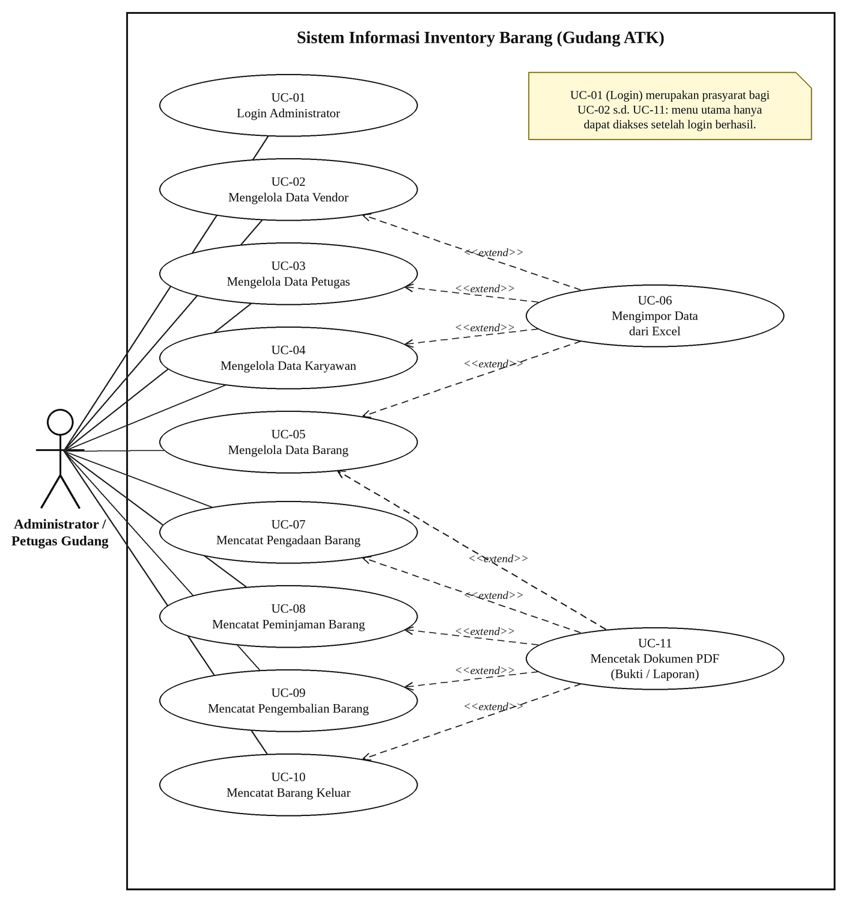

*Gambar B.1 Use Case Diagram Sistem Informasi Inventory Barang (Gudang
ATK)*

## B.4 Use Case Scenario

Berikut skenario untuk dua fitur utama sistem.

<table>
<colgroup>
<col style="width: 25%" />
<col style="width: 74%" />
</colgroup>
<thead>
<tr class="header">
<th><strong>Komponen</strong></th>
<th><strong>Penjelasan Skenario</strong></th>
</tr>
</thead>
<tbody>
<tr class="odd">
<td><strong>Nama Use Case</strong></td>
<td>Mencatat Peminjaman Barang (UC-08)</td>
</tr>
<tr class="even">
<td><strong>Aktor</strong></td>
<td>Administrator / Petugas Gudang</td>
</tr>
<tr class="odd">
<td><strong>Deskripsi</strong></td>
<td>Use case ini menjelaskan bagaimana administrator mencatat barang ATK
yang dipinjam atau diberikan kepada karyawan, sehingga stok barang
berkurang dan nota peminjaman dapat dicetak.</td>
</tr>
<tr class="even">
<td><strong>Normal Course (Alur Normal)</strong></td>
<td>
1. Administrator membuka menu Transaksi › Peminjaman.

2. Sistem menampilkan ID peminjaman otomatis (PJM###) serta pilihan
karyawan, petugas, dan barang berstok lebih dari nol.

3. Administrator memilih karyawan, petugas, tanggal pinjam, serta
tanggal kembali bila status Dipinjam.

4. Administrator memilih barang, mengisi jumlah, memilih status
(Dipinjam/Diberikan), lalu menekan Tambah; item masuk ke tabel.

5. Administrator menekan Simpan.

6. Sistem memvalidasi data, menyimpan header dan detail peminjaman,
serta mengurangi stok barang.

7. Sistem menampilkan pesan “Data berhasil disimpan!”.
</td>
</tr>
<tr class="odd">
<td><strong>Alternative Course</strong></td>
<td>Pada langkah 4, jika jumlah kosong atau tanggal kembali belum diisi
untuk status Dipinjam, sistem menampilkan pesan peringatan dan item
tidak ditambahkan. Pada langkah 5, jika belum ada item, sistem
menampilkan pesan “Detail barang untuk ID ini masih kosong!”.</td>
</tr>
<tr class="even">
<td><strong>Pre-Condition</strong></td>
<td>Administrator telah <em>login</em>, data master barang, karyawan,
dan petugas tersedia, dan MySQL aktif.</td>
</tr>
<tr class="odd">
<td><strong>Post-Condition</strong></td>
<td>Data peminjaman tersimpan pada tabel peminjaman dan
detail_peminjaman, serta stok pada tabel barang berkurang sesuai
jumlah.</td>
</tr>
</tbody>
</table>

<table>
<colgroup>
<col style="width: 25%" />
<col style="width: 74%" />
</colgroup>
<thead>
<tr class="header">
<th><strong>Komponen</strong></th>
<th><strong>Penjelasan Skenario</strong></th>
</tr>
</thead>
<tbody>
<tr class="odd">
<td><strong>Nama Use Case</strong></td>
<td>Mencatat Pengembalian Barang (UC-09)</td>
</tr>
<tr class="even">
<td><strong>Aktor</strong></td>
<td>Administrator / Petugas Gudang</td>
</tr>
<tr class="odd">
<td><strong>Deskripsi</strong></td>
<td>Use case ini menjelaskan pencatatan pengembalian barang pinjaman
beserta kondisinya, sehingga status peminjaman diperbarui dan stok
bertambah kembali jika barang dalam kondisi baik.</td>
</tr>
<tr class="even">
<td><strong>Normal Course (Alur Normal)</strong></td>
<td>
1. Administrator membuka menu Transaksi › Pengembalian.

2. Sistem menampilkan ID pengembalian otomatis (KMB###) dan daftar ID
pinjam yang masih berstatus Dipinjam.

3. Administrator memilih ID pinjam; sistem mengisi data peminjam dan
barang.

4. Administrator memilih tanggal kembali dan kondisi barang
(Good/Broken), lalu menekan Simpan.

5. Sistem menyimpan header dan detail pengembalian serta mengubah
status item menjadi Dikembalikan.

6. Jika tidak ada lagi item berstatus Dipinjam, sistem mengubah
status peminjaman menjadi Dikembalikan.

7. Jika kondisi Good, sistem menambah stok barang sebesar jumlah yang
dikembalikan, lalu menampilkan pesan “Data berhasil disimpan”.
</td>
</tr>
<tr class="odd">
<td><strong>Alternative Course</strong></td>
<td>Pada langkah 4, jika ID pinjam, tanggal, atau data barang belum
lengkap, sistem menampilkan pesan peringatan. Jika barang sudah tidak
berstatus Dipinjam, sistem menampilkan pesan “Barang ini sudah tidak
berstatus Dipinjam!”. Jika kondisi Broken, stok tidak ditambah.</td>
</tr>
<tr class="even">
<td><strong>Pre-Condition</strong></td>
<td>Terdapat minimal satu item peminjaman berstatus Dipinjam.</td>
</tr>
<tr class="odd">
<td><strong>Post-Condition</strong></td>
<td>Data pengembalian tersimpan, status peminjaman diperbarui, dan stok
barang bertambah bila kondisi Good.</td>
</tr>
</tbody>
</table>

## B.5 Activity Diagram

Activity Diagram disusun dari use case pada B.2. Jumlah diagram sama
dengan jumlah use case, yaitu sebelas (AD-01 sampai AD-11), dan setiap
diagram menggunakan *swimlane* untuk memisahkan aktivitas aktor dan
sistem. Simbol yang dipakai: lingkaran hitam sebagai status awal,
lingkaran dengan titik hitam sebagai status akhir, persegi bersudut
bulat sebagai aktivitas, dan belah ketupat sebagai percabangan
(*decision*).

**AD-01 Activity Diagram Login Administrator (UC-01)**

> 1\. Administrator membuka aplikasi sehingga form Login tampil.
>
> 2\. Administrator mengisi *username* dan *password*.
>
> 3\. Administrator menekan tombol Login.
>
> 4\. Sistem memvalidasi *username* dan *password* pada tabel login.
>
> 5\. Jika data valid, sistem menampilkan Menu Utama; jika tidak, sistem
> menampilkan pesan “Login Gagal!”.
>
> 6\. Selesai.

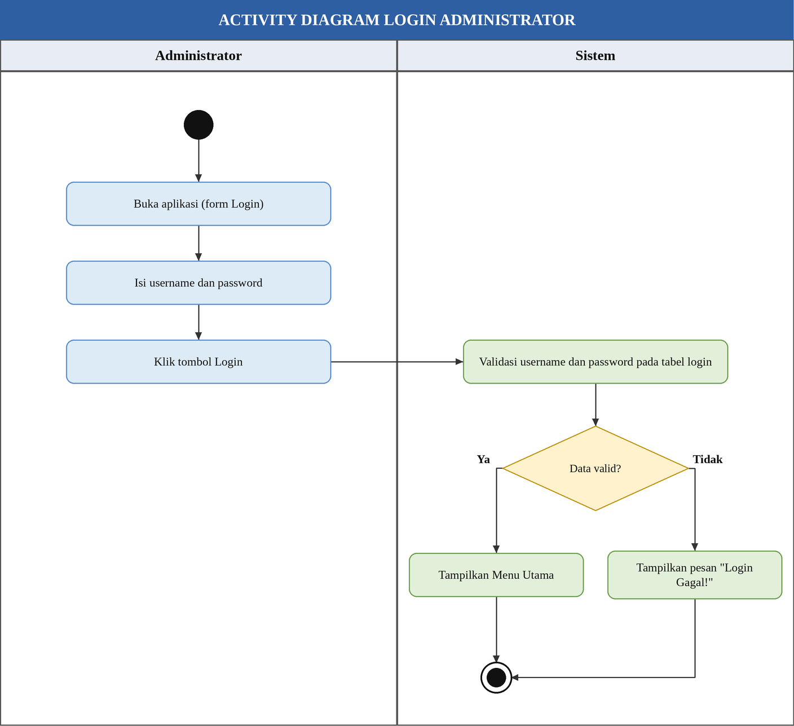

*Gambar B.2 Activity Diagram Login Administrator*

**AD-02 Activity Diagram Mengelola Data Vendor (UC-02)**

> 1\. Administrator membuka menu Master › Vendor.
>
> 2\. Sistem menampilkan form, tabel vendor, dan ID otomatis (VND###).
>
> 3\. Administrator mengisi nama, alamat, dan telp, atau memilih baris
> pada tabel.
>
> 4\. Administrator menekan tombol Simpan, Edit, atau Hapus.
>
> 5\. Sistem memvalidasi data dan aksi yang dipilih.
>
> 6\. Jika valid, sistem menjalankan INSERT/UPDATE/DELETE pada tabel
> vendor dan memuat ulang tabel; jika tidak, sistem menampilkan pesan
> peringatan.
>
> 7\. Selesai.

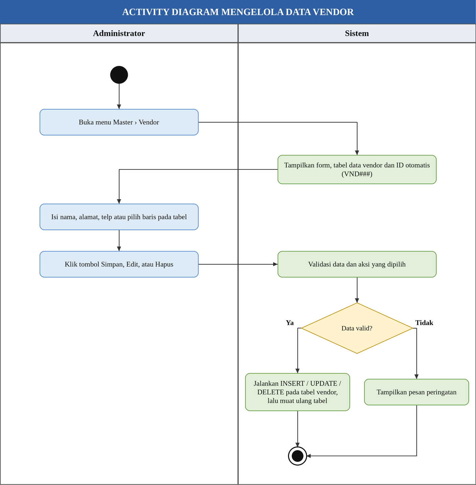

*Gambar B.3 Activity Diagram Mengelola Data Vendor*

**AD-03 Activity Diagram Mengelola Data Petugas (UC-03)**

> 1\. Administrator membuka menu Master › Petugas.
>
> 2\. Sistem menampilkan form, tabel petugas, dan ID otomatis (PTG###).
>
> 3\. Administrator mengisi nama, jabatan, dan telp, atau memilih baris
> pada tabel.
>
> 4\. Administrator menekan tombol Simpan, Edit, atau Hapus.
>
> 5\. Sistem memvalidasi data dan aksi yang dipilih (misalnya baris
> harus dipilih untuk Edit/Hapus).
>
> 6\. Jika valid, sistem menjalankan INSERT/UPDATE/DELETE pada tabel
> petugas dan memuat ulang tabel; jika tidak, sistem menampilkan pesan
> peringatan.
>
> 7\. Selesai.

*Gambar B.4 Activity Diagram Mengelola Data Petugas*

**AD-04 Activity Diagram Mengelola Data Karyawan (UC-04)**

> 1\. Administrator membuka menu Master › Karyawan.
>
> 2\. Sistem menampilkan form, tabel karyawan, dan ID otomatis (KRY###).
>
> 3\. Administrator mengisi nama, jabatan, dan telp, atau memilih baris
> pada tabel.
>
> 4\. Administrator menekan tombol Simpan, Edit, atau Hapus.
>
> 5\. Sistem memvalidasi kelengkapan data, pemilihan baris, dan
> konfirmasi penghapusan.
>
> 6\. Jika valid, sistem menjalankan INSERT/UPDATE/DELETE pada tabel
> karyawan dan memuat ulang tabel; jika tidak, sistem menampilkan pesan
> peringatan.
>
> 7\. Selesai.

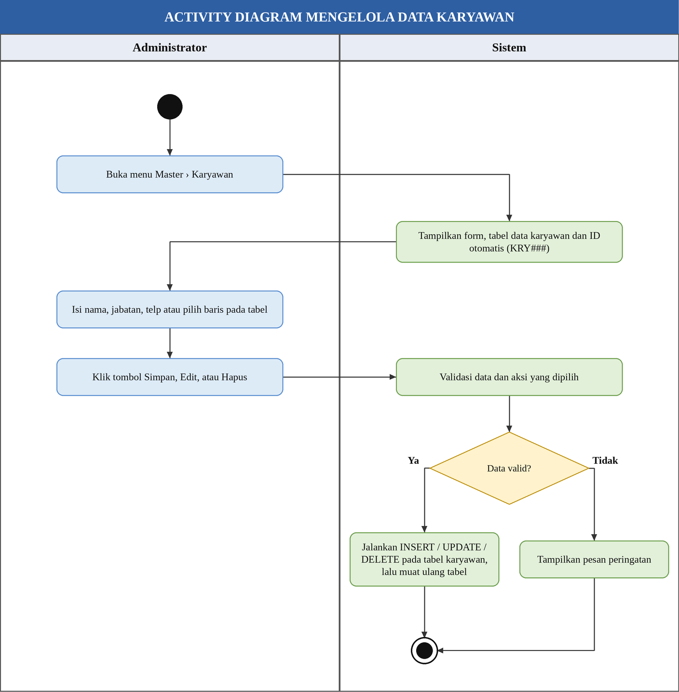

*Gambar B.5 Activity Diagram Mengelola Data Karyawan*

**AD-05 Activity Diagram Mengelola Data Barang (UC-05)**

> 1\. Administrator membuka menu Master › Barang.
>
> 2\. Sistem menampilkan form dan tabel data barang.
>
> 3\. Administrator mengisi kode, nama, stok, harga, dan tanggal, atau
> memilih baris pada tabel.
>
> 4\. Administrator menekan tombol Simpan, Edit, atau Hapus.
>
> 5\. Sistem memvalidasi data dan aksi yang dipilih.
>
> 6\. Jika valid, sistem menjalankan INSERT/UPDATE/DELETE pada tabel
> barang dan memuat ulang tabel; jika tidak, sistem menampilkan pesan
> peringatan.
>
> 7\. Selesai.

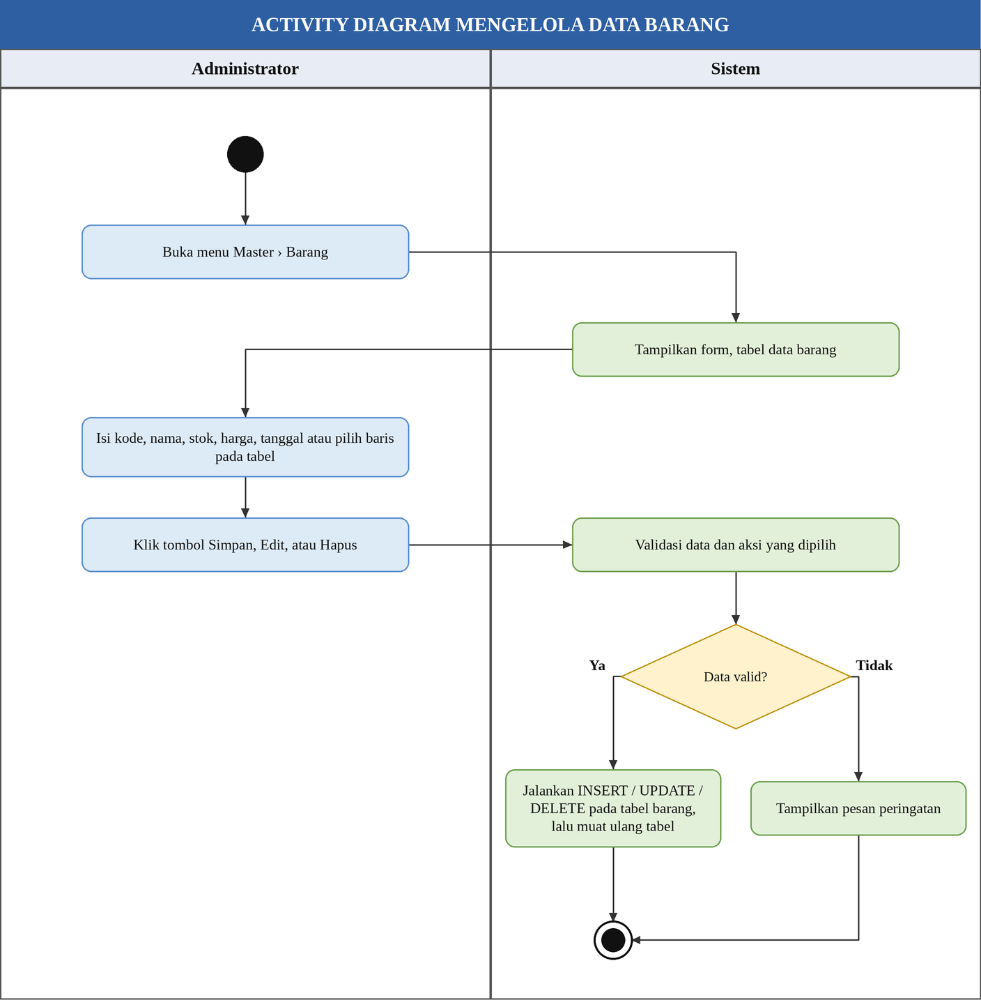

*Gambar B.6 Activity Diagram Mengelola Data Barang*

**AD-06 Activity Diagram Mengimpor Data dari Excel (UC-06)**

> 1\. Administrator menekan tombol Import pada form master.
>
> 2\. Sistem menampilkan dialog pemilih berkas.
>
> 3\. Administrator memilih berkas Excel (.xlsx).
>
> 4\. Sistem membaca setiap baris Excel menggunakan Apache POI.
>
> 5\. Jika baris valid, sistem menyimpan baris ke tabel; jika tidak,
> baris dilewati.
>
> 6\. Sistem menampilkan pesan hasil import dan memuat ulang tabel.
>
> 7\. Selesai.

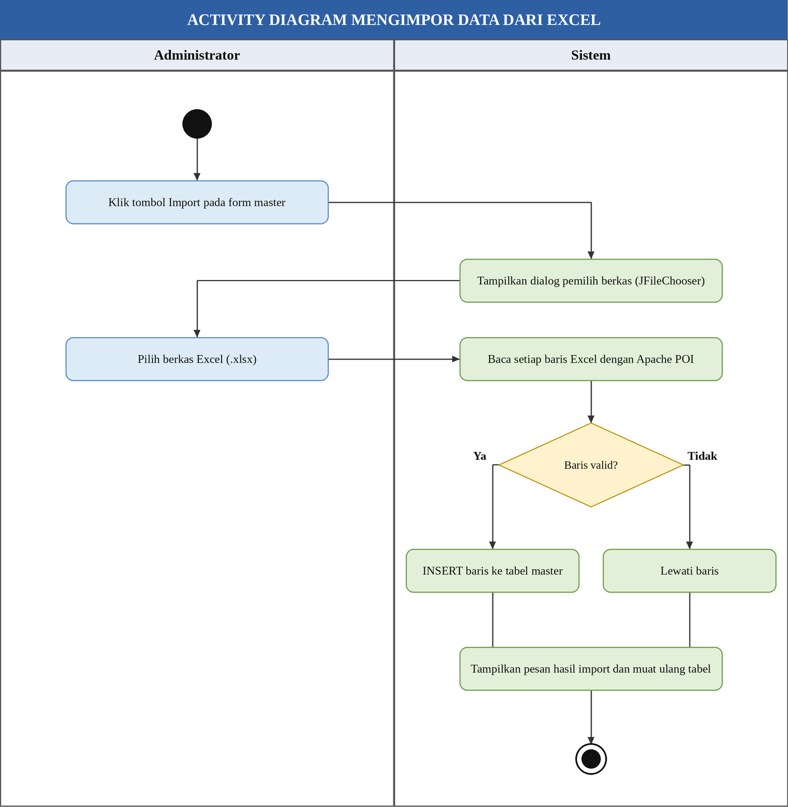

*Gambar B.7 Activity Diagram Mengimpor Data dari Excel*

**AD-07 Activity Diagram Mencatat Pengadaan Barang (UC-07)**

> 1\. Administrator membuka menu Transaksi › Pengadaan.
>
> 2\. Sistem menampilkan form, ID otomatis (PGD###), serta daftar
> barang, vendor, dan petugas.
>
> 3\. Administrator memilih barang, vendor, petugas, lalu mengisi jumlah
> dan harga.
>
> 4\. Administrator menekan Tambah (item masuk tabel), kemudian menekan
> Simpan.
>
> 5\. Sistem menghitung total dan memvalidasi item, vendor, serta
> petugas.
>
> 6\. Jika valid, sistem menyimpan header dan detail pengadaan, menambah
> stok barang, lalu *commit*; jika tidak, sistem menampilkan pesan
> peringatan atau *rollback*.
>
> 7\. Selesai.

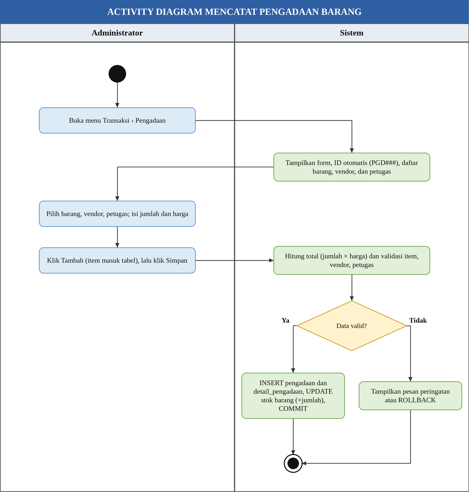

*Gambar B.8 Activity Diagram Mencatat Pengadaan Barang*

**AD-08 Activity Diagram Mencatat Peminjaman Barang (UC-08)**

> 1\. Administrator membuka menu Transaksi › Peminjaman.
>
> 2\. Sistem menampilkan form, ID otomatis (PJM###), barang berstok
> lebih dari nol, karyawan, dan petugas.
>
> 3\. Administrator memilih karyawan, barang, jumlah, status
> (Dipinjam/Diberikan), dan tanggal.
>
> 4\. Administrator menekan Tambah (item masuk tabel), kemudian menekan
> Simpan.
>
> 5\. Sistem memvalidasi tanggal, jumlah, dan item.
>
> 6\. Jika valid, sistem menyimpan header dan detail peminjaman serta
> mengurangi stok barang; jika tidak, sistem menampilkan pesan
> peringatan.
>
> 7\. Selesai.

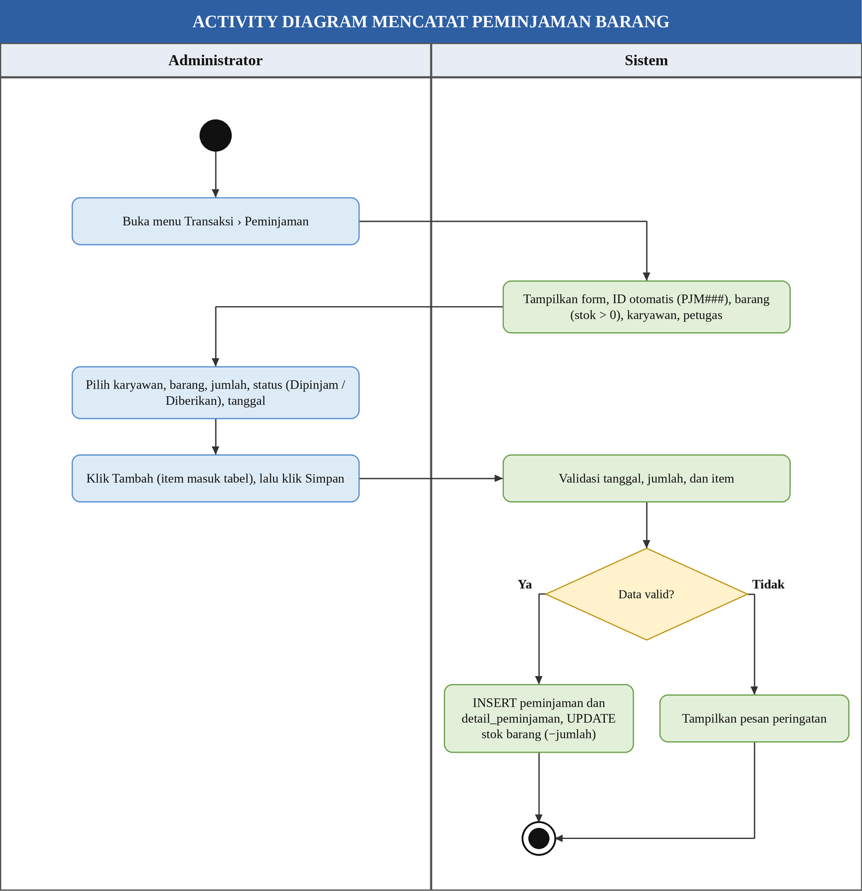

*Gambar B.9 Activity Diagram Mencatat Peminjaman Barang*

**AD-09 Activity Diagram Mencatat Pengembalian Barang (UC-09)**

> 1\. Administrator membuka menu Transaksi › Pengembalian.
>
> 2\. Sistem menampilkan form, ID otomatis (KMB###), dan ID pinjam
> berstatus Dipinjam.
>
> 3\. Administrator memilih ID pinjam, tanggal kembali, dan kondisi
> barang (Good/Broken).
>
> 4\. Administrator menekan tombol Simpan.
>
> 5\. Sistem memvalidasi data dan memeriksa barang masih berstatus
> Dipinjam.
>
> 6\. Jika valid, sistem menyimpan pengembalian dan detail serta
> mengubah status item menjadi Dikembalikan; jika kondisi Good, sistem
> menambah stok barang.
>
> 7\. Jika tidak valid, sistem menampilkan pesan peringatan.
>
> 8\. Selesai.

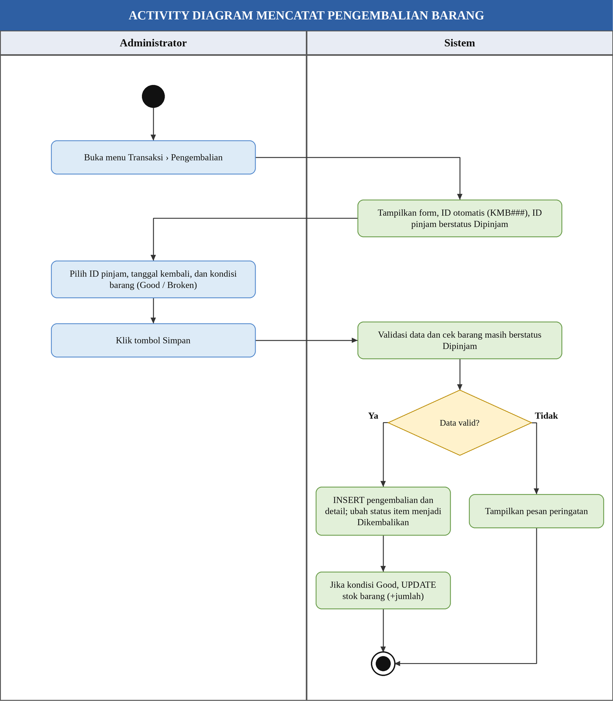

*Gambar B.10 Activity Diagram Mencatat Pengembalian Barang*

**AD-10 Activity Diagram Mencatat Barang Keluar (UC-10)**

> 1\. Administrator membuka menu Transaksi › Barang Keluar.
>
> 2\. Sistem menampilkan form, ID otomatis (KLR###), barang berstok
> lebih dari nol, petugas, dan tujuan.
>
> 3\. Administrator memilih tujuan, petugas, barang, lalu mengisi jumlah
> dan *date input*.
>
> 4\. Administrator menekan Tambah (item masuk tabel), kemudian menekan
> Simpan.
>
> 5\. Sistem memvalidasi tujuan, petugas, dan item.
>
> 6\. Jika valid, sistem menyimpan header dan detail barang keluar lalu
> *commit*; jika tidak, sistem menampilkan pesan peringatan atau
> *rollback*.
>
> 7\. Selesai.

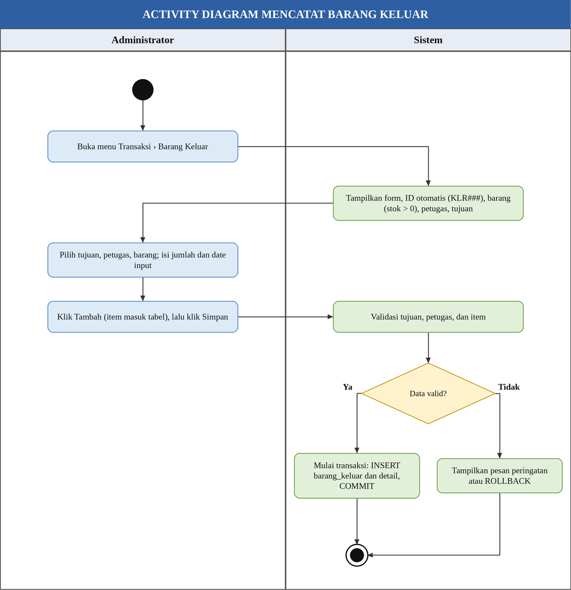

*Gambar B.11 Activity Diagram Mencatat Barang Keluar*

**AD-11 Activity Diagram Mencetak Dokumen PDF (UC-11)**

> 1\. Administrator mengisi ID dan tanggal cetak pada form transaksi
> lalu menekan Cetak.
>
> 2\. Sistem memvalidasi tanggal cetak.
>
> 3\. Jika tanggal terisi, sistem mengambil data header dan detail
> transaksi dari database.
>
> 4\. Sistem menyusun dokumen PDF dengan iText dan menyimpannya ke
> folder per tanggal.
>
> 5\. Sistem menampilkan pesan PDF berhasil dibuat; jika tanggal kosong,
> sistem menampilkan pesan peringatan.
>
> 6\. Selesai.

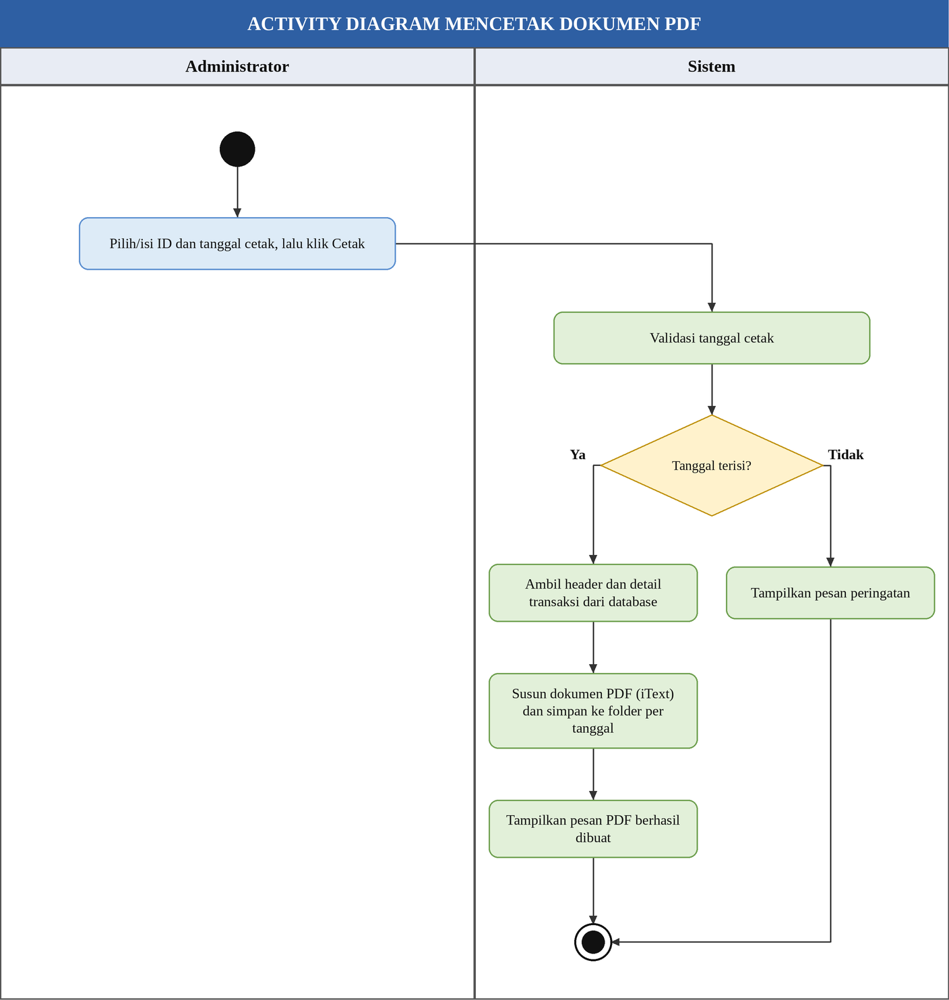

*Gambar B.12 Activity Diagram Mencetak Dokumen PDF*

## B.6 Sequence Diagram

Sequence Diagram disusun dari Activity Diagram pada B.5, sehingga
jumlahnya juga sebelas (SD-01 sampai SD-11). Diagram memakai empat jenis
objek: *actor* (pengguna), *boundary* (form antarmuka Java Swing),
*control* (pengendali proses, yaitu kelas *Koneksi*, Apache POI, dan
iText), dan *entity* (tabel basis data MySQL atau berkas). Garis tegas
menunjukkan pesan yang dikirim, garis putus-putus menunjukkan nilai
kembalian, dan kotak *alt* menunjukkan alur alternatif.

**SD-01 Sequence Diagram Login Administrator (UC-01)**

Administrator mengisi *username* dan *password* pada form Login. Login
memanggil Koneksi dan memeriksa tabel login; bila valid MenuUtama
ditampilkan, bila tidak pesan “Login Gagal!” ditampilkan.

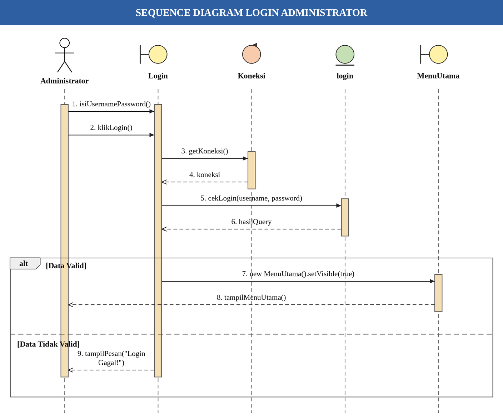

*Gambar B.13 Sequence Diagram Login Administrator*

**SD-02 Sequence Diagram Mengelola Data Vendor (UC-02)**

form_vendor membangkitkan ID otomatis dan memuat tabel vendor, lalu
menjalankan INSERT, UPDATE, atau DELETE sesuai tombol yang ditekan
administrator.

*Gambar B.14 Sequence Diagram Mengelola Data Vendor*

**SD-03 Sequence Diagram Mengelola Data Petugas (UC-03)**

form_petugas membangkitkan ID otomatis dan memuat tabel petugas, lalu
menjalankan INSERT, UPDATE, atau DELETE sesuai tombol yang ditekan
administrator.

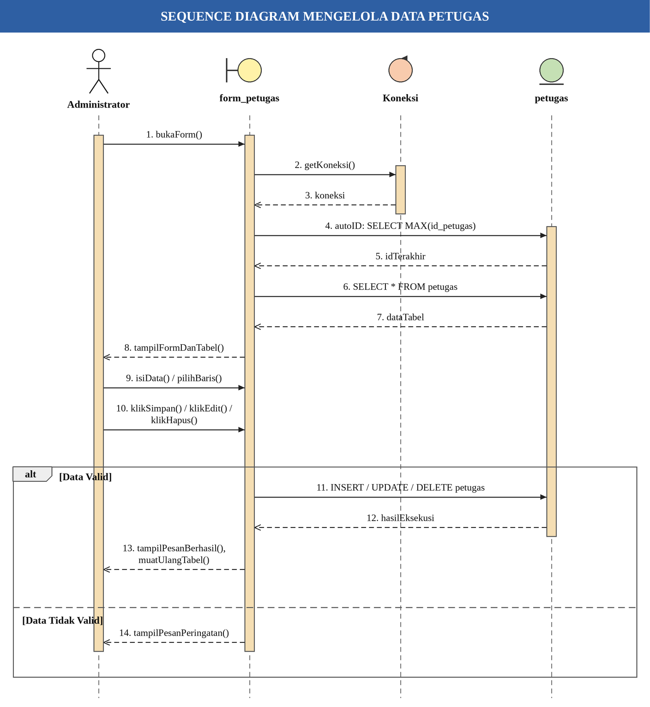

*Gambar B.15 Sequence Diagram Mengelola Data Petugas*

**SD-04 Sequence Diagram Mengelola Data Karyawan (UC-04)**

form_karyawan membangkitkan ID otomatis dan memuat tabel karyawan, lalu
menjalankan INSERT, UPDATE, atau DELETE setelah validasi kelengkapan
data.

*Gambar B.16 Sequence Diagram Mengelola Data Karyawan*

**SD-05 Sequence Diagram Mengelola Data Barang (UC-05)**

form_barang memuat tabel barang lalu menjalankan INSERT, UPDATE, atau
DELETE berdasarkan kode barang.

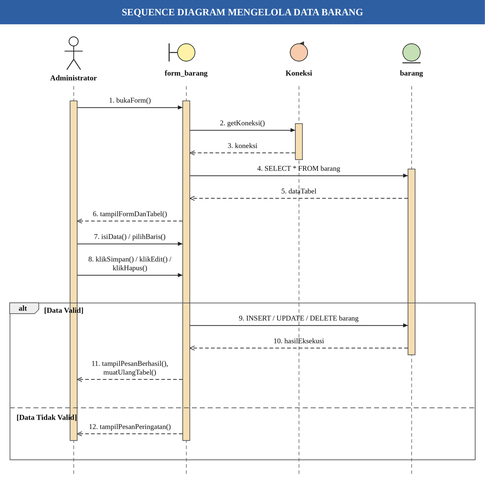

*Gambar B.17 Sequence Diagram Mengelola Data Barang*

**SD-06 Sequence Diagram Mengimpor Data dari Excel (UC-06)**

form_barang membaca berkas Excel melalui Apache POI dan menyimpan setiap
baris valid ke tabel barang; baris tidak valid dilewati (proses yang
sama berlaku pada form Vendor, Petugas, dan Karyawan).

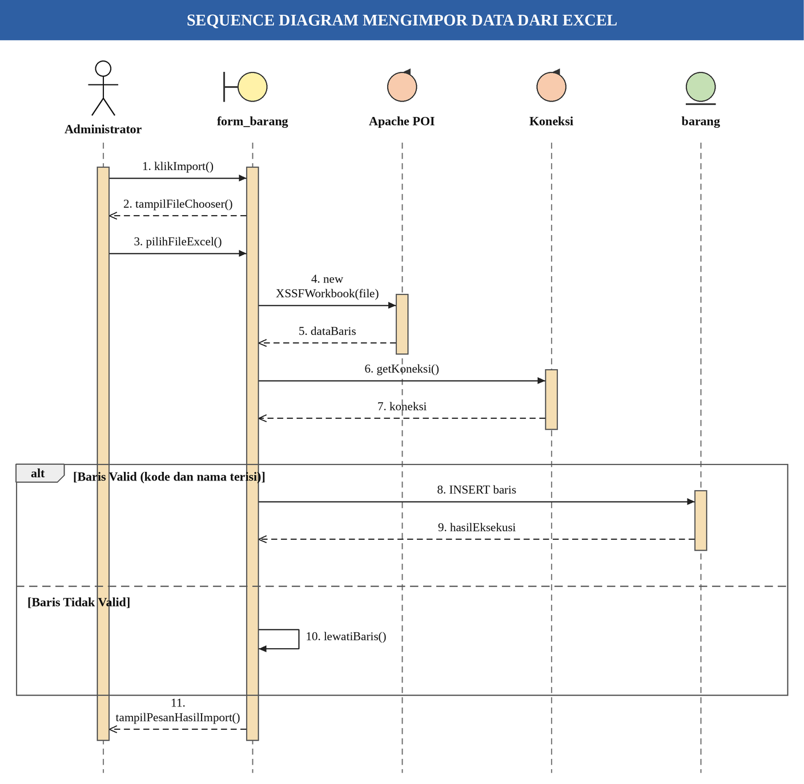

*Gambar B.18 Sequence Diagram Mengimpor Data dari Excel*

**SD-07 Sequence Diagram Mencatat Pengadaan Barang (UC-07)**

form_pengadaan menyimpan header, detail, dan menambah stok barang dalam
satu transaksi (*commit*), atau melakukan *rollback* bila gagal.

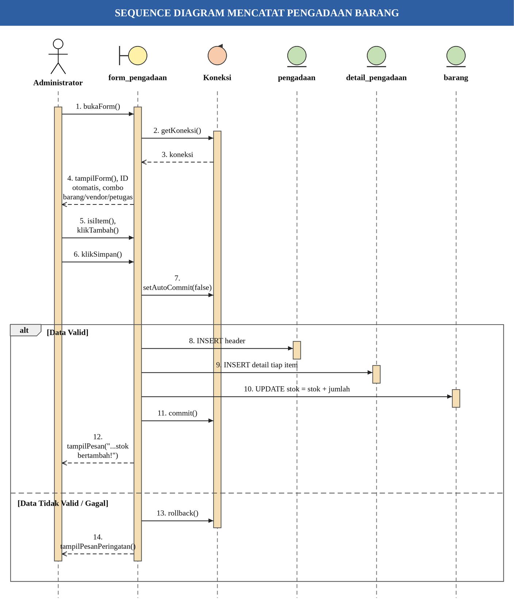

*Gambar B.19 Sequence Diagram Mencatat Pengadaan Barang*

**SD-08 Sequence Diagram Mencatat Peminjaman Barang (UC-08)**

form_peminjaman menyimpan header dan detail peminjaman, lalu mengurangi
stok pada tabel barang.

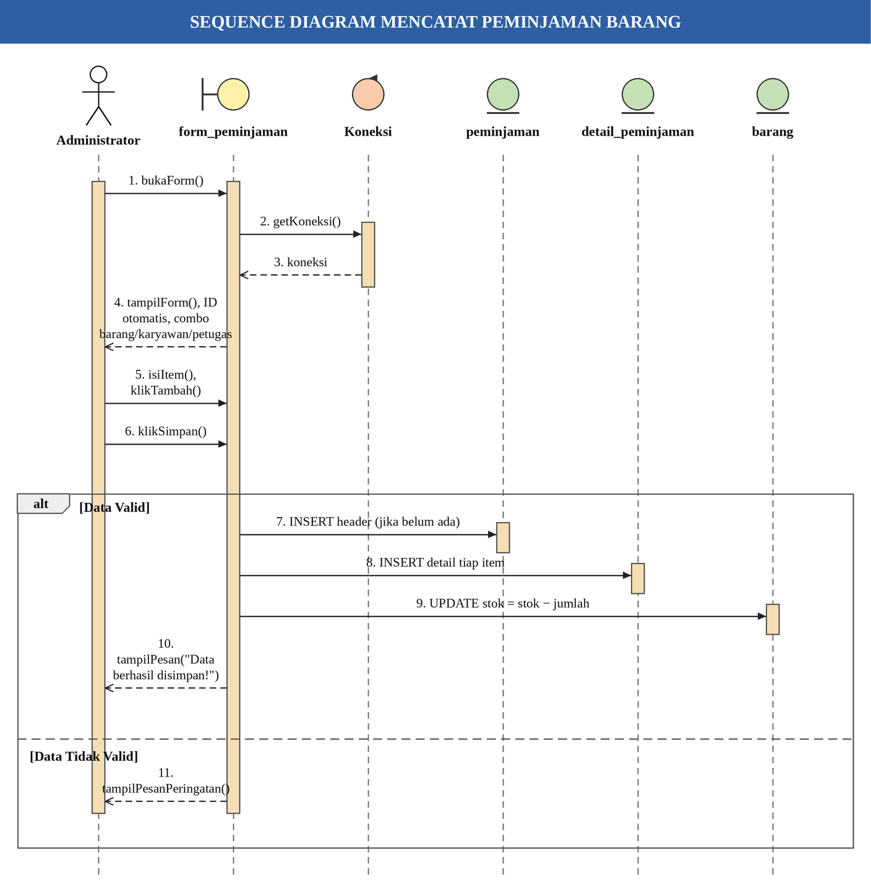

*Gambar B.20 Sequence Diagram Mencatat Peminjaman Barang*

**SD-09 Sequence Diagram Mencatat Pengembalian Barang (UC-09)**

form_pengembalian menyimpan pengembalian, mengubah status detail
peminjaman menjadi Dikembalikan, dan menambah stok bila kondisi barang
Good.

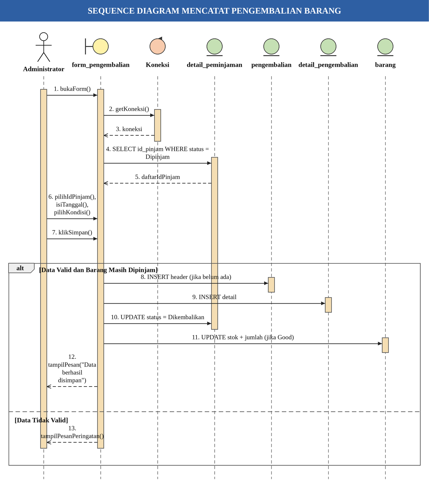

*Gambar B.21 Sequence Diagram Mencatat Pengembalian Barang*

**SD-10 Sequence Diagram Mencatat Barang Keluar (UC-10)**

form_barang_keluar menyimpan header dan detail barang keluar dalam satu
transaksi (*commit*) atau melakukan *rollback* bila gagal.

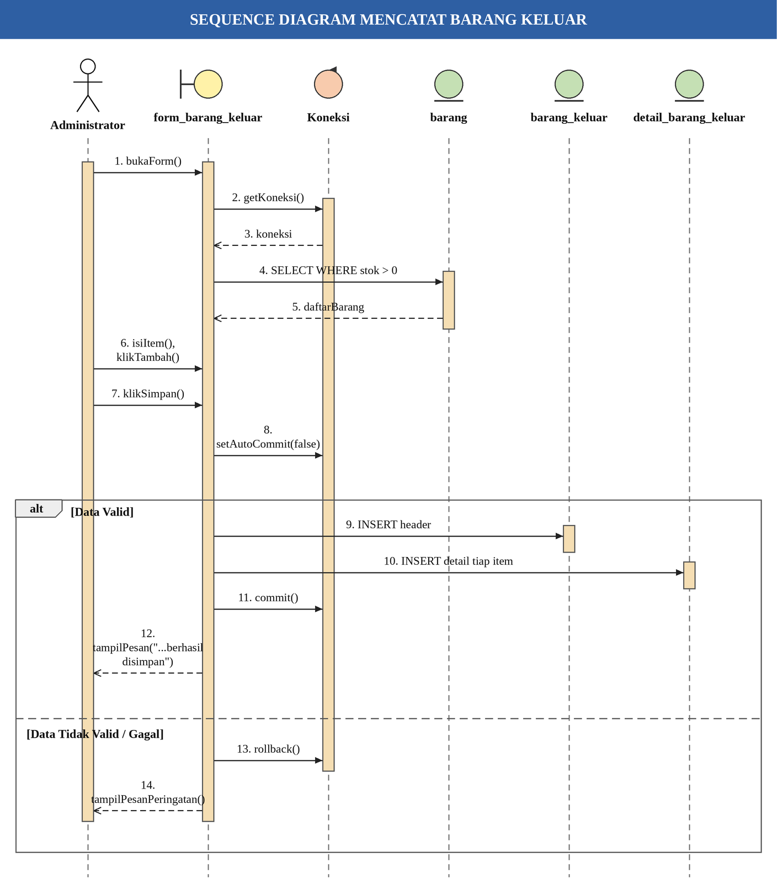

*Gambar B.22 Sequence Diagram Mencatat Barang Keluar*

**SD-11 Sequence Diagram Mencetak Dokumen PDF (UC-11)**

Form transaksi (contoh: form_pengadaan) mengambil data dari basis data,
iText menyusun dokumen, dan berkas PDF disimpan pada folder per tanggal.
Proses yang sama berlaku pada form Peminjaman, Pengembalian, Barang
Keluar, dan Barang.

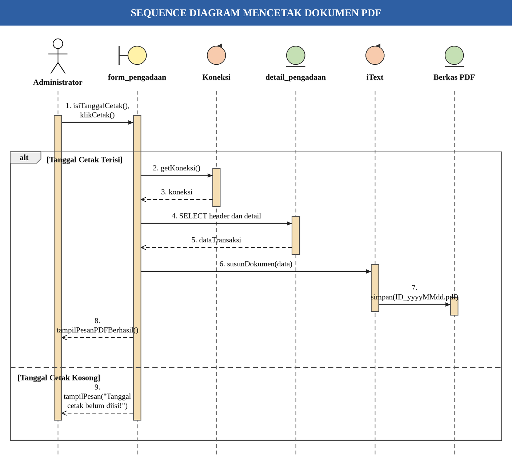

*Gambar B.23 Sequence Diagram Mencetak Dokumen PDF*

## B.7 State Machine Diagram

State Machine Diagram menggambarkan perubahan status (*state*) objek
**Item Peminjaman Barang** sejak ditambahkan ke tabel sementara pada
form Peminjaman hingga proses selesai. Objek ini dipilih karena memiliki
siklus hidup paling lengkap yang melibatkan tiga transaksi (peminjaman,
pengembalian, dan pembaruan stok). Diagram memiliki satu *initial state*
dan satu *final state*. Notasi yang dipakai: lingkaran hitam sebagai
*initial state*, persegi bersudut bulat sebagai *state*, panah berlabel
sebagai *event*, teks dalam kurung siku sebagai *guard*, dan lingkaran
bertitik hitam sebagai *final state*.

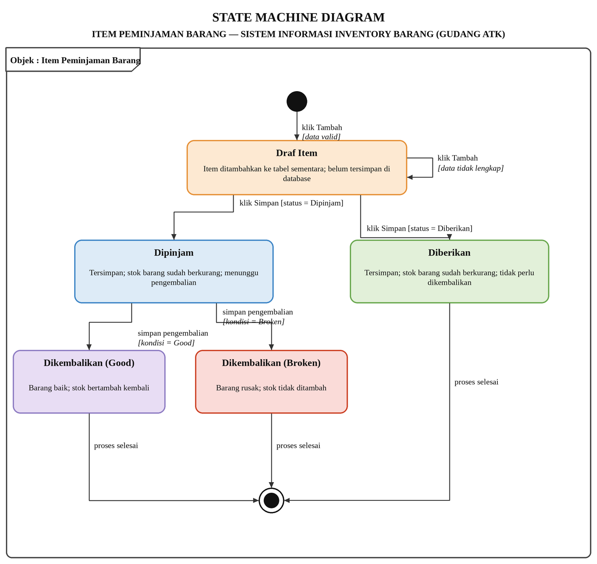

*Gambar B.24 State Machine Diagram Item Peminjaman Barang*

**Penjelasan State**

| **State**                 | **Penjelasan**                                                                                                                                         |
|---------------------------|--------------------------------------------------------------------------------------------------------------------------------------------------------|
| **Draf Item**             | Item sudah ditambahkan ke tabel sementara pada form Peminjaman namun belum disimpan ke basis data. Jika data tidak lengkap, item tetap pada state ini. |
| **Dipinjam**              | Item tersimpan dengan status Dipinjam (tanggal kembali wajib), stok barang sudah berkurang, dan item menunggu pengembalian.                            |
| **Diberikan**             | Item tersimpan dengan status Diberikan, stok barang sudah berkurang, dan item tidak perlu dikembalikan.                                                |
| **Dikembalikan (Good)**   | Barang dikembalikan dalam kondisi baik; status item menjadi Dikembalikan dan stok barang bertambah kembali.                                            |
| **Dikembalikan (Broken)** | Barang dikembalikan dalam kondisi rusak; status item menjadi Dikembalikan namun stok barang tidak ditambah.                                            |

**Penjelasan Alur**

> 1\. Alur dimulai saat administrator menekan Tambah dengan data valid,
> sehingga item berada pada state Draf Item.
>
> 2\. Saat administrator menekan Simpan, status item menentukan state
> berikutnya: Dipinjam atau Diberikan, dan stok barang dikurangi.
>
> 3\. Item berstatus Dipinjam berpindah ke Dikembalikan (Good) atau
> Dikembalikan (Broken) ketika pengembalian disimpan, sesuai kondisi
> barang.
>
> 4\. Item Diberikan, Dikembalikan (Good), dan Dikembalikan (Broken)
> mengakhiri alur pada final state. Penghapusan transaksi peminjaman
> oleh administrator mengembalikan stok sesuai jumlah item (lihat
> FR-27).

## B.8 Class Diagram

Class Diagram menggambarkan struktur data (basis data MySQL) sistem
beserta atribut, operasi, dan hubungan antar kelas. Penyusunan mengikuti
lima langkah pada materi: (1) mengelompokkan atribut pada dokumen, (2)
menentukan *primary key* dan ketergantungan atribut, (3) menentukan nama
entitas, (4) menggambarkan hubungan antar entitas, dan (5) menentukan
*multiplicity*. Notasi visibilitas: **+** (*public*) untuk *primary key*
dan operasi, **-** (*private*) untuk atribut biasa, dan **\#**
(*protected*) untuk *foreign key*.

**Langkah 1 - Mengelompokkan atribut pada dokumen**

| **Kelompok** | **Sumber dokumen**          | **Atribut**                                                            |
|--------------|-----------------------------|------------------------------------------------------------------------|
| Kelompok 1   | Form Login                  | Username, Password                                                     |
| Kelompok 2   | Form Data Barang            | KodeBarang, NamaBarang, Stok, Harga, Tanggal                           |
| Kelompok 3   | Form Data Vendor            | IdVendor, NamaVendor, Alamat, Telp                                     |
| Kelompok 4   | Form Data Petugas           | IdPetugas, NamaPetugas, Jabatan, Telp                                  |
| Kelompok 5   | Form Data Karyawan          | IdKaryawan, NamaKaryawan, Jabatan, Telp                                |
| Kelompok 6   | Form Pengadaan (header)     | IdPengadaan, Vendor, Petugas                                           |
| Kelompok 7   | Form Pengadaan (item)       | KodeBarang, NamaBarang, Jumlah, Harga, Total, TanggalInput             |
| Kelompok 8   | Form Peminjaman (header)    | IdPinjam, TanggalPinjam, TanggalKembali, NamaKaryawan, Petugas, Status |
| Kelompok 9   | Form Peminjaman (item)      | KodeBarang, NamaBarang, Jumlah, Status                                 |
| Kelompok 10  | Form Pengembalian (header)  | IdKembali, TanggalKembali, NamaPeminjam, Petugas, Status               |
| Kelompok 11  | Form Pengembalian (item)    | IdPinjam, KodeBarang, NamaBarang, Jumlah, KondisiBarang                |
| Kelompok 12  | Form Barang Keluar (header) | IdKeluar, Tanggal, Tujuan, Petugas                                     |
| Kelompok 13  | Form Barang Keluar (item)   | KodeBarang, NamaBarang, Jumlah, DateInput                              |

**Langkah 2 - Menentukan primary key dan ketergantungan atribut**

Atribut yang sudah unik dijadikan *primary key* (diberi tanda *). Bila
belum ada,* primary key\* dibuat baru. Atribut NamaBarang pada kelompok
item bergantung pada KodeBarang sehingga dinormalisasi ke kelas Barang
(pada implementasi disimpan juga pada tabel detail untuk memudahkan
pencetakan).

| **Kelompok** | **Primary key**            | **Atribut yang bergantung**                                  |
|--------------|----------------------------|--------------------------------------------------------------|
| Kelompok 1   | Username\*                 | Password                                                     |
| Kelompok 2   | KodeBarang\*               | NamaBarang, Stok, Harga, Tanggal                             |
| Kelompok 3   | IdVendor\*                 | NamaVendor, Alamat, Telp                                     |
| Kelompok 4   | IdPetugas\*                | NamaPetugas, Jabatan, Telp                                   |
| Kelompok 5   | IdKaryawan\*               | NamaKaryawan, Jabatan, Telp                                  |
| Kelompok 6   | IdPengadaan\*              | Vendor, Petugas                                              |
| Kelompok 7   | IdPengadaan *+ KodeBarang* | Jumlah, Harga, Total, TanggalInput                           |
| Kelompok 8   | IdPinjam\*                 | TanggalPinjam, TanggalKembali, NamaKaryawan, Petugas, Status |
| Kelompok 9   | IdPinjam *+ KodeBarang*    | Jumlah, Status                                               |
| Kelompok 10  | IdKembali\*                | TanggalKembali, NamaPeminjam, Petugas, Status                |
| Kelompok 11  | IdDetail\* (dibuat baru)   | IdKembali, IdPinjam, KodeBarang, Jumlah, KondisiBarang       |
| Kelompok 12  | IdKeluar\*                 | Tanggal, Tujuan, Petugas                                     |
| Kelompok 13  | IdKeluar *+ KodeBarang*    | Jumlah, DateInput                                            |

**Langkah 3 - Menentukan nama entitas**

| **Kelompok** | **Nama entitas**   | **Keterangan**                                                |
|--------------|--------------------|---------------------------------------------------------------|
| Kelompok 1   | Login              | Akun administrator yang masuk ke aplikasi.                    |
| Kelompok 2   | Barang             | Data barang ATK beserta stok dan harga.                       |
| Kelompok 3   | Vendor             | Data pemasok barang.                                          |
| Kelompok 4   | Petugas            | Data petugas pencatat transaksi.                              |
| Kelompok 5   | Karyawan           | Data karyawan peminjam barang.                                |
| Kelompok 6   | Pengadaan          | Header transaksi pembelian barang dari vendor.                |
| Kelompok 7   | DetailPengadaan    | Item barang pada satu transaksi pengadaan.                    |
| Kelompok 8   | Peminjaman         | Header transaksi peminjaman barang.                           |
| Kelompok 9   | DetailPeminjaman   | Item barang pada satu transaksi peminjaman beserta statusnya. |
| Kelompok 10  | Pengembalian       | Header transaksi pengembalian barang.                         |
| Kelompok 11  | DetailPengembalian | Item barang yang dikembalikan beserta kondisinya.             |
| Kelompok 12  | BarangKeluar       | Header transaksi pengeluaran barang dari gudang.              |
| Kelompok 13  | DetailBarangKeluar | Item barang pada satu transaksi barang keluar.                |

**Langkah 4 - Menggambarkan hubungan antar entitas**

> 1\. Setiap transaksi (Pengadaan, Peminjaman, Pengembalian,
> BarangKeluar) memiliki satu atau lebih item detail, digambarkan
> sebagai relasi komposisi.
>
> 2\. Setiap item detail merujuk ke satu Barang melalui \#KodeBarang,
> sedangkan satu Barang dapat muncul pada banyak item detail.
>
> 3\. Setiap Pengadaan mencatat satu Vendor (#Vendor) dan setiap
> Peminjaman mencatat satu Karyawan (#NamaKaryawan).
>
> 4\. Setiap transaksi dicatat oleh satu Petugas (#Petugas); satu
> Petugas dapat mencatat banyak transaksi.
>
> 5\. DetailPengembalian merujuk ke Pengembalian (#IdKembali) dan ke
> transaksi asal (#IdPinjam).

**Langkah 5 - Menentukan multiplicity**

| **Relasi**                        | **Kiri** | **Kanan** | **Makna**                                                     |
|-----------------------------------|----------|-----------|---------------------------------------------------------------|
| Pengadaan - DetailPengadaan       | 1        | 1..\*     | Satu pengadaan memiliki satu sampai banyak item.              |
| Peminjaman - DetailPeminjaman     | 1        | 1..\*     | Satu peminjaman memiliki satu sampai banyak item.             |
| Pengembalian - DetailPengembalian | 1        | 1..\*     | Satu pengembalian memiliki satu sampai banyak item.           |
| BarangKeluar - DetailBarangKeluar | 1        | 1..\*     | Satu transaksi keluar memiliki satu sampai banyak item.       |
| Detail (4 kelas) - Barang         | 0..\*    | 1         | Satu barang dapat dipakai pada nol sampai banyak item detail. |
| Vendor - Pengadaan                | 1        | 0..\*     | Satu vendor dapat dipakai pada nol sampai banyak pengadaan.   |
| Karyawan - Peminjaman             | 1        | 0..\*     | Satu karyawan dapat melakukan nol sampai banyak peminjaman.   |
| Petugas - transaksi (4 kelas)     | 1        | 0..\*     | Satu petugas dapat mencatat nol sampai banyak transaksi.      |

**Hasil Class Diagram**

Hasil akhir ditunjukkan pada Gambar B.25. Kelas detail digambarkan
berwarna biru dan terhubung ke kelas header dengan relasi komposisi.
Operasi pada setiap kelas disesuaikan dengan pesan pada Sequence Diagram
(B.6). Pada implementasi, referensi vendor, petugas, dan karyawan pada
tabel transaksi disimpan sebagai nilai nama (teks), bukan kunci asing
numerik.

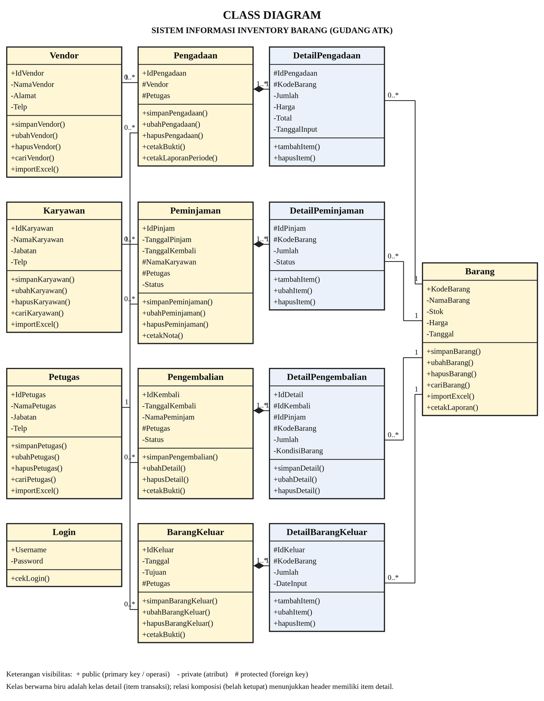

*Gambar B.25 Class Diagram Sistem Informasi Inventory Barang (Gudang
ATK)*

## B.9 Deployment Diagram

Deployment Diagram memetakan rancangan arsitektur fisik sistem, yaitu
perangkat keras (*node*) tempat sistem dipasang, perangkat lunak
(*artifact*) yang dijalankan pada setiap *node*, dan jalur komunikasi di
antaranya. Komponen yang digunakan: *boundary/frame* sebagai batas
sistem, *node* dengan stereotype «device» untuk perangkat keras dan
«executionEnvironment» untuk perangkat lunak, *artifact* dengan
stereotype «artifact», serta *communication path* yang diberi label
jenis komunikasinya.

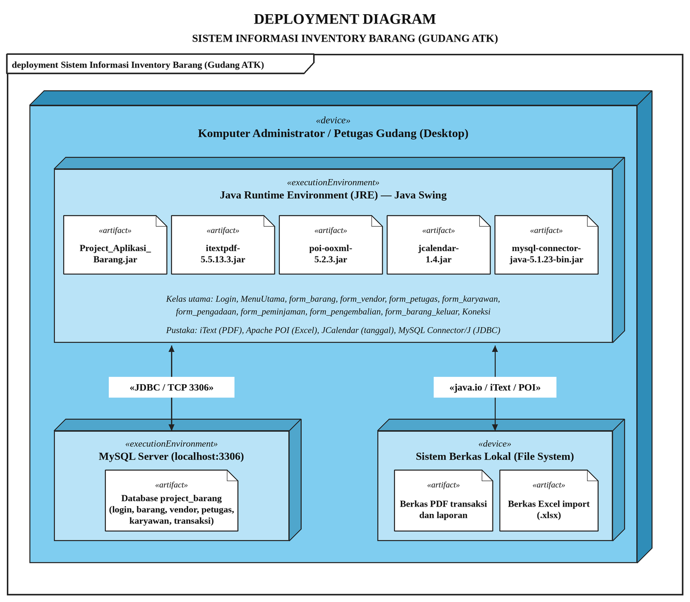

*Gambar B.26 Deployment Diagram Sistem Informasi Inventory Barang
(Gudang ATK)*

**Penjelasan Node dan Artifact**

| **Node**                                | **Stereotype**         | **Keterangan dan artifact**                                                                                                                                              |
|-----------------------------------------|------------------------|--------------------------------------------------------------------------------------------------------------------------------------------------------------------------|
| Komputer Administrator / Petugas Gudang | «device»               | Komputer desktop tempat seluruh sistem dipasang dan dioperasikan.                                                                                                        |
| Java Runtime Environment (JRE)          | «executionEnvironment» | Menjalankan artifact Project_Aplikasi_Barang.jar beserta pustaka itextpdf-5.5.13.3.jar, poi-ooxml-5.2.3.jar, jcalendar-1.4.jar, dan mysql-connector-java-5.1.23-bin.jar. |
| MySQL Server (localhost:3306)           | «executionEnvironment» | Menyimpan artifact basis data project_barang (tabel login, barang, vendor, petugas, karyawan, dan tabel transaksi).                                                      |
| Sistem Berkas Lokal                     | «device»               | Menyimpan artifact berkas PDF hasil cetak (per kategori dan tanggal) serta berkas Excel (.xlsx) yang diimpor.                                                            |

**Penjelasan Communication Path**

| **Jalur**           | **Stereotype**          | **Keterangan**                                                               |
|---------------------|-------------------------|------------------------------------------------------------------------------|
| JRE - MySQL Server  | «JDBC / TCP 3306»       | Aplikasi mengakses basis data melalui MySQL Connector/J (lihat 3.3 dan 3.4). |
| JRE - Sistem Berkas | «java.io / iText / POI» | Aplikasi menulis berkas PDF dan membaca berkas Excel.                        |

Seluruh komponen berjalan pada satu komputer (*localhost*) sehingga
tidak ada komunikasi jaringan antar-perangkat pada versi ini.

## B.10 Model Analisis Lain (Direncanakan)

- Entity Relationship Diagram (ERD) basis data project_barang.

- Flowchart alur pembaruan stok pada transaksi pengadaan, peminjaman,
  pengembalian, dan barang keluar.

# Appendix C: To Be Determined List

- Pengurangan stok otomatis pada transaksi Barang Keluar (versi 1.0 baru
  mencatat header dan detail transaksi).

- Validasi jumlah peminjaman dan barang keluar agar tidak melebihi stok
  yang tersedia.

- Penyimpanan *password* secara terenkripsi (*hash*), pengelolaan akun
  pengguna, dan fitur *logout*.

- Penggunaan *PreparedStatement* pada seluruh kueri (beberapa form
  master masih menyusun kueri dengan penggabungan teks).

- Penyimpanan peminjaman dan pengembalian dalam satu transaksi basis
  data (*commit*/*rollback*) seperti pada pengadaan dan barang keluar.

- Pengaturan kredensial basis data dan lokasi penyimpanan PDF melalui
  berkas konfigurasi.

- Laporan periode untuk transaksi selain pengadaan serta laporan stok
  minimum.
